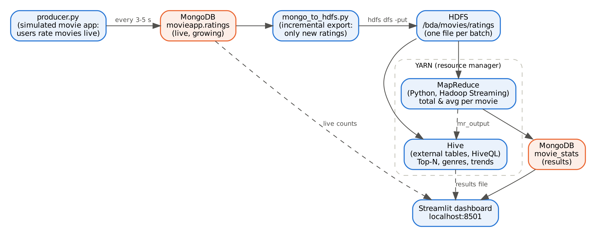

# Live Movie-Rating Analytics — Hadoop MapReduce + Hive + MongoDB

Big Data Analytics (BCS714D) project, Gopalan College of Engineering & Management — **Assignment Q3**:
*Implement a MapReduce program to analyse a movie-rating dataset by calculating the total or average rating for each movie.*

Instead of a static file, ratings arrive **live**: a producer streams MovieLens ratings into **MongoDB**, each pipeline run copies only the new ratings into **HDFS**, a **Python MapReduce** job (Hadoop Streaming) computes count / total / average per movie on **YARN**, **Hive** runs analysis queries on the same data, and results go back to MongoDB and a **Streamlit** dashboard.



## Documentation
- [Installation guide (requirements + full setup)](docs/INSTALLATION.md)
- [How it was built (design, steps, problems solved)](docs/HOW_IT_WAS_BUILT.md)
- [Running, clearing and viewing results](docs/RUNNING.md)

## Tech stack
Hadoop 3.3.6 (HDFS, YARN, MapReduce + Streaming) · Hive 3.1.3 · MongoDB 8.0 · Python 3.10 (PyMongo) · Streamlit · Ubuntu 22.04 on WSL2 · OpenJDK 8

## Files
| File | Purpose |
|---|---|
| `producer.py` | Simulated movie app: streams ratings into MongoDB (`movieapp.ratings`) |
| `mongo_to_hdfs.py` | Incremental ingestion: copies only new ratings to HDFS (`/bda/movies/ratings`) |
| `mapper.py`, `reducer.py` | MapReduce job: `movieId → count, total, average` |
| `stats_to_mongo.py` | Writes MapReduce results back to MongoDB (`movie_stats`) |
| `movie_analysis.hql` | 7 Hive queries (Top-N, most rated, genres, distribution, arrival trend) |
| `run_pipeline.sh` | One full cycle: MongoDB → HDFS → MapReduce → MongoDB → Hive |
| `dashboard.py` | Live dashboard (http://localhost:8501) |

## Dataset
[MovieLens ml-latest-small](https://grouplens.org/datasets/movielens/latest/) (GroupLens): 100,836 ratings, 9,742 movies, 610 users.
Not included in this repo (license) — download it into the project folder:
```bash
wget https://files.grouplens.org/datasets/movielens/ml-latest-small.zip && unzip ml-latest-small.zip
```

## Run
Prerequisites: see [docs/INSTALLATION.md](docs/INSTALLATION.md).
```bash
start-dfs.sh && start-yarn.sh                                   # Hadoop
python3 -m streamlit run dashboard.py --server.headless true    # tab 1: dashboard
python3 producer.py ml-latest-small 500 3                       # tab 2: live data
./run_pipeline.sh                                               # tab 3: run, then run again later
```

## Results (run 2 — 46,100 live ratings)
- Data grew 600 → 5,100 → 46,100 ratings between runs; each run picked up only new data.
- **MapReduce Top 10 = Hive Top 10** (cross-verified). Highest rated: *The Shawshank Redemption* — 4.45 (151 ratings). Most rated: *Forrest Gump* (160).
- Best genres: Film-Noir 3.95, War 3.83; lowest: Horror 3.25. Most common rating: 4.0.

## Author
Nithelan Jayakumar — B.E. CSE, Gopalan College of Engineering & Management, Bengaluru
